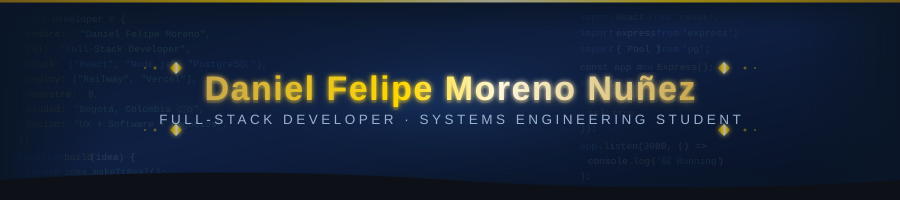

<div align="center">



<br/>

[](https://linkedin.com/in/Danpro2626)
[](mailto:danielfelipemorenonunez294@gmail.com)
[](mailto:dmorenon@unbosque.edu.co)
[](https://maps.google.com/?q=Bogota,Colombia)

</div>

<br/>

---

## Sobre mí

```typescript
const daniel = {
  nombre      : "Daniel Felipe Moreno Nuñez",
  rol         : "Full-Stack Developer",
  universidad : "Universidad El Bosque — Ingeniería de Sistemas (8° semestre)",
  ubicacion   : "Bogotá, Colombia",
  intereses   : ["Desarrollo de Software", "UX / Diseño de Interfaces", "Negocios Digitales"],
  actualmente : "Desarrollando NeoCity Shield — Proyecto de Grado en producción",
  enfoque     : "Construir productos que funcionen bien por dentro y se vean bien por fuera",
};
```

Soy un desarrollador full-stack con sólida formación en desarrollo de software, bases de datos relacionales y diseño de interfaces centradas en el usuario. Me especializo en el stack **React + Node.js + PostgreSQL**, con despliegue en entornos cloud como Railway y Vercel. Trabajo de forma propositiva, comunicativa y siempre orientado a resolver problemas reales con soluciones funcionales y accesibles.

<br/>

---

## Stack Tecnológico

<div align="center">

**Frontend**


**Backend**


**Base de Datos**


**Lenguajes**


**DevOps y Herramientas**


**Análisis de Datos**


</div>

<br/>

---

## Proyectos

### NeoCity Shield — Aplicativo Web de Seguridad Física

**Proyecto de Grado · Evidencia Digital S.A.S. · 2026 – Presente**

Aplicación web full-stack para el reporte y gestión de incidentes de seguridad física, desarrollada en colaboración con Evidencia Digital S.A.S. como proyecto de grado de Ingeniería de Sistemas.

| Capa | Tecnología | Plataforma |
|:-----|:-----------|:-----------|
| Frontend | React | Vercel |
| Backend | Node.js + Express | Railway |
| Base de datos | PostgreSQL | Railway |

- Proyecto en producción con ambos entornos conectados y funcionales
- Arquitectura relacional completa en PostgreSQL
- Interfaz centrada en usabilidad y experiencia del operador
- Despliegue continuo en Railway y Vercel

<br/>

### Aplicación de Gestión — Municipio de Caqueza

**Software 2 · Universidad El Bosque · 2025-2**

Aplicación funcional desarrollada para cubrir necesidades reales de gestión del Municipio de Caqueza, siguiendo el ciclo completo de desarrollo de software: análisis de requerimientos, diseño, implementación y pruebas.

<br/>

### Formularios Digitales — Fundación Los Pisingos

**Labor Social · Universidad El Bosque · 2025-2**

Diseño e implementación de formularios digitales de vacaciones y permisos para el área de Gestión Humana, integrados directamente con Excel para optimizar los procesos internos de la fundación.

<br/>

### Mapa Interactivo de Accesibilidad — Campus El Bosque

**Modelos y Simulación de Sistemas · Universidad El Bosque · 2025-2**

Mapa interactivo del campus universitario orientado a personas en situación de discapacidad, mejorando la experiencia de navegación y accesibilidad dentro del campus.

<br/>

### Prototipo — Sistema de Seguridad Institucional

**Seminario de Investigación · Universidad El Bosque · 2025**

Prototipo de sistema de seguridad institucional para la Universidad El Bosque. Investigación aplicada con levantamiento de requerimientos y diseño de solución integral.

<br/>

---

## GitHub Stats

<div align="center">


&nbsp;&nbsp;


</div>

<br/>

---

## Proyecto en Producción

Mi proyecto de grado está desplegado y funcionando en producción. El repositorio vive en una cuenta dedicada al equipo de desarrollo.

| | |
|:--|:--|
| Aplicación en vivo | [neocity-shield.vercel.app](https://neocity-shield.vercel.app) |
| Repositorio | [github.com/neocityshield-jpg/neocity-shield](https://github.com/neocityshield-jpg/neocity-shield) |
| Estado | En producción — 184+ commits |
| Stack | React · Node.js · Express · PostgreSQL · Railway · Vercel |

<br/>

---

## Educación

| Período | Título | Institución |
|:--------|:-------|:------------|
| 2022 – 2026 | Ingeniería de Sistemas | Universidad El Bosque |
| 2021 | Bachiller Académico | Colegio Santa Mariana de Jesús |

<br/>

---

## Contacto

<div align="center">

| Canal | Información |
|:------|:------------|
| Correo personal | danielfelipemorenonunez294@gmail.com |
| Correo universitario | dmorenon@unbosque.edu.co |
| Teléfono | 305 707 2352 |
| LinkedIn | [linkedin.com/in/Danpro2626](https://linkedin.com/in/Danpro2626) |
| Ubicación | Bogotá, Colombia |

</div>

<br/>

---

<div align="center">


*"Construir productos que funcionen bien por dentro y se vean bien por fuera."*

<br/>


</div>
